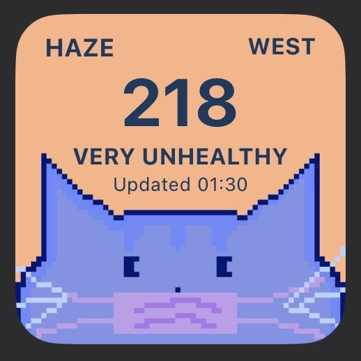

# hazy-days
A pixel-art iOS haze widget for Singapore built using Scriptable.

## Features

- Live PSI readings
- North / South / East / West / Central regions
- Automatic haze-status detection
- Pixel-art backgrounds
- Displays the latest API update time
- Configurable region using Scriptable widget parameters

## Built With

- JavaScript
- Scriptable
- data.gov.sg PSI API
- Pixel art illustrations 

## Setup

1. Install Scriptable on iOS.
2. Create a new Scriptable script.
3. Copy the contents of `haze-widget.js`.
4. Import the images from the `assets` folder into Scriptable.
5. Add a Scriptable widget to your Home Screen.
6. Select the HazeSG script.
7. Set the widget parameter to:
   `west`, `east`, `north`, `south`, or `central`

## Preview 

